#  Blood-Brain Barrier Penetration with a Random Forest

A drug for a brain disease only works if it can actually **reach the brain**. Most
molecules are blocked by the blood-brain barrier (BBB). This project predicts, from a
molecule's structure alone (its SMILES string), whether it will cross the BBB — using a
**single random forest** model.

## Results

Evaluated on a **scaffold split**: test molecules have core structures (Bemis-Murcko
scaffolds) never seen in training, which mimics predicting genuinely new drug candidates
and is much harder than a random split.

| Metric (held-out test, 408 molecules) | Score | 95% bootstrap CI |
|---|---|---|
| ROC-AUC | **0.882** | 0.847 – 0.914 |
| PR-AUC | 0.897 | 0.857 – 0.932 |
| Balanced accuracy (tuned threshold 0.85) | 0.789 | |
| MCC (tuned threshold 0.85) | 0.577 | |
| F1 / accuracy at threshold 0.5 | 0.791 / 0.726 | 0.75 – 0.83 / 0.68 – 0.77 |
| 5-fold scaffold-grouped CV ROC-AUC (train) | 0.890 | |

The scaffold split shifts class balance (82% BBB+ in train vs 54% in test), which is why
accuracy at the default 0.5 threshold trails the ranking metrics. A threshold chosen on
training-set cross-validation fixes most of that (see [How far can we trust it?](#how-far-can-we-trust-it)).

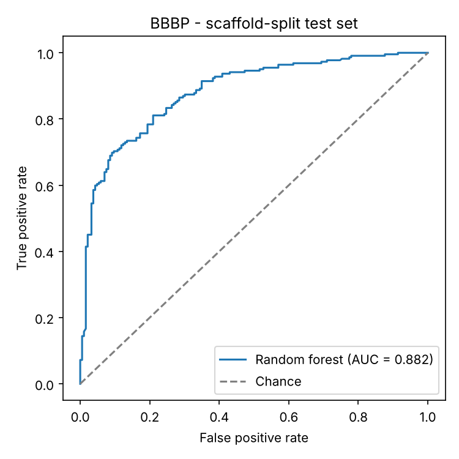

*How well the model separates "crosses" from "blocked" at every possible cutoff. The more the blue curve bows toward the top-left, the better; the dashed diagonal is random guessing. The area under it (AUC) is 0.882.*

### What the model learned

The most important features are the ones medicinal chemists already use to judge brain
penetration — a good sanity check:

- **TPSA** (topological polar surface area) — polar molecules struggle to cross
- **NumHDonors / NHOHCount** — hydrogen-bond donors hurt permeability
- **MolLogP** — lipophilicity helps passive diffusion through membranes
- **qed** — overall drug-likeness

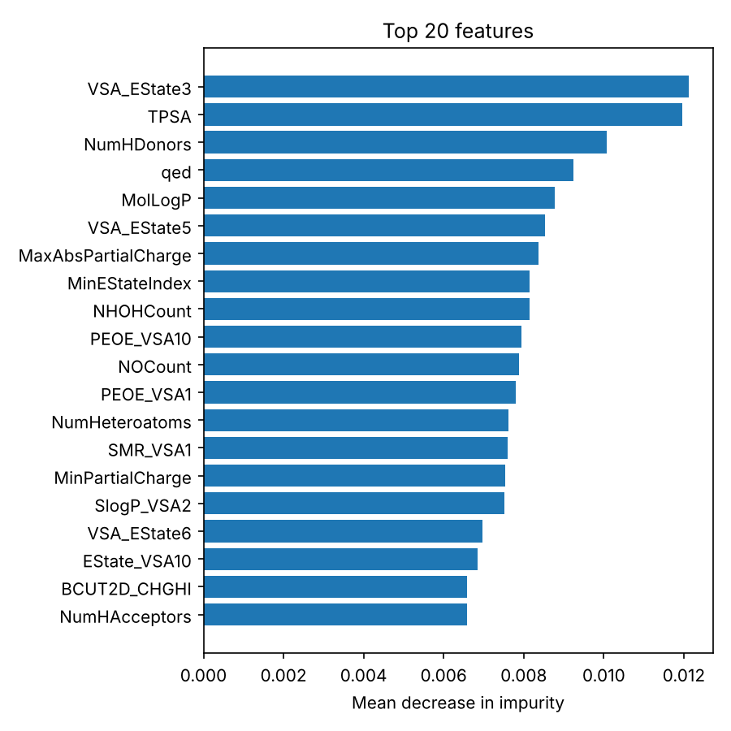

*The random forest's own ranking of which features it leaned on most. Longer bars = more used. It shows how much each feature matters, but not in which direction — SHAP (below) adds that.*

## SHAP analysis: why the model decides what it decides

`src/explain.py` runs exact TreeSHAP on the final random forest (400 sampled molecules)
to show how each feature pushes a prediction towards **crosses the BBB** (positive SHAP)
or **blocked** (negative SHAP).

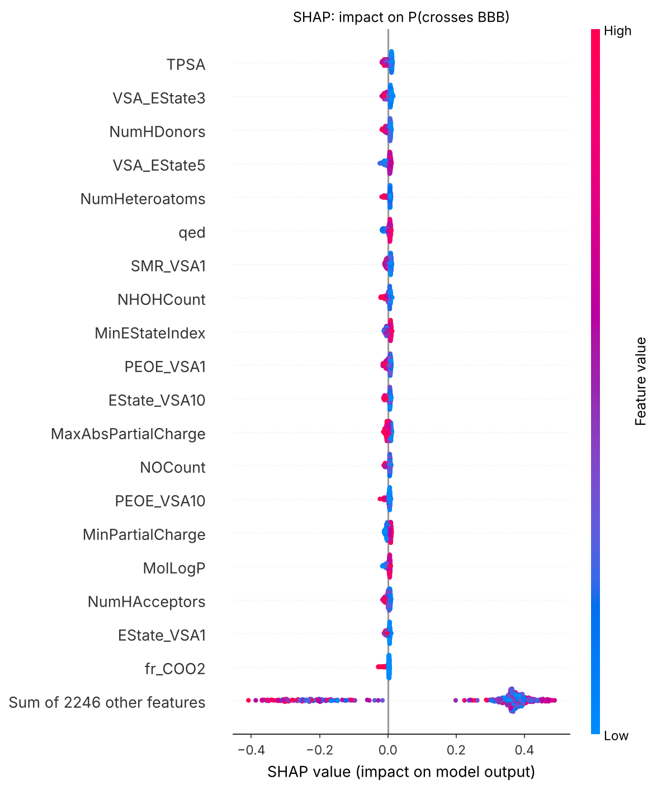

*Each dot is one molecule. Dots to the right pushed that molecule toward "crosses", dots to the left toward "blocked". Colour is the feature's value (red = high, blue = low). For TPSA, red dots sit on the left: high polar surface area pushes toward "blocked".*

Ranked by overall importance (mean absolute SHAP across all molecules):

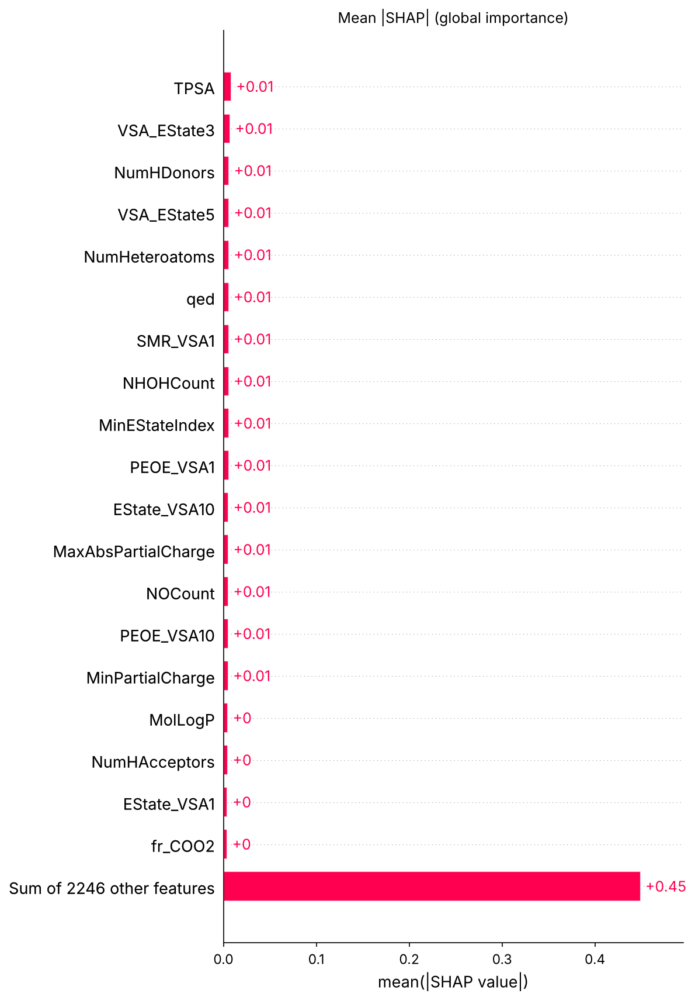

*The beeswarm summarised to one bar per feature: the average size of each feature's push, ignoring direction — a plain "which features matter most" ranking.*

Key findings (red = high feature value):

- **TPSA is the #1 driver.** High polar surface area strongly lowers P(BBB+). The
  dependence plot shows SHAP flipping sign at **~80-90 Ų**, rediscovering the
  medicinal-chemistry rule of thumb that CNS drugs need TPSA < 90 Ų — learned from data alone.
- **H-bond donors, N/O counts and heteroatoms** all push towards "blocked".
- **Lipophilicity (MolLogP) and drug-likeness (qed)** push towards "crosses".
- **Carboxylic acids (`fr_COO2`)** are penalised: they are charged at blood pH and
  rarely cross membranes.
- The "sum of other features" row is large because signal is spread across thousands of
  correlated fingerprint bits and descriptors — individual features each contribute a
  little, but together they separate the classes clearly.

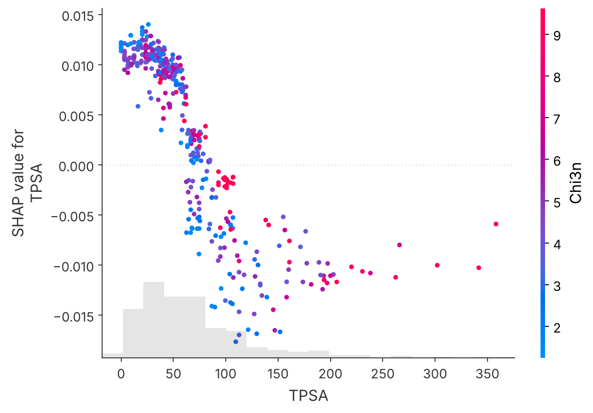

*X-axis is the actual TPSA value; Y-axis is how much it pushed the prediction. The trend crosses zero at ~80–90 Ų — above that, TPSA pushes toward "blocked". The model found the known "TPSA < 90 for brain drugs" rule on its own.*

Lipophilicity works the other way — higher MolLogP nudges predictions towards "crosses":

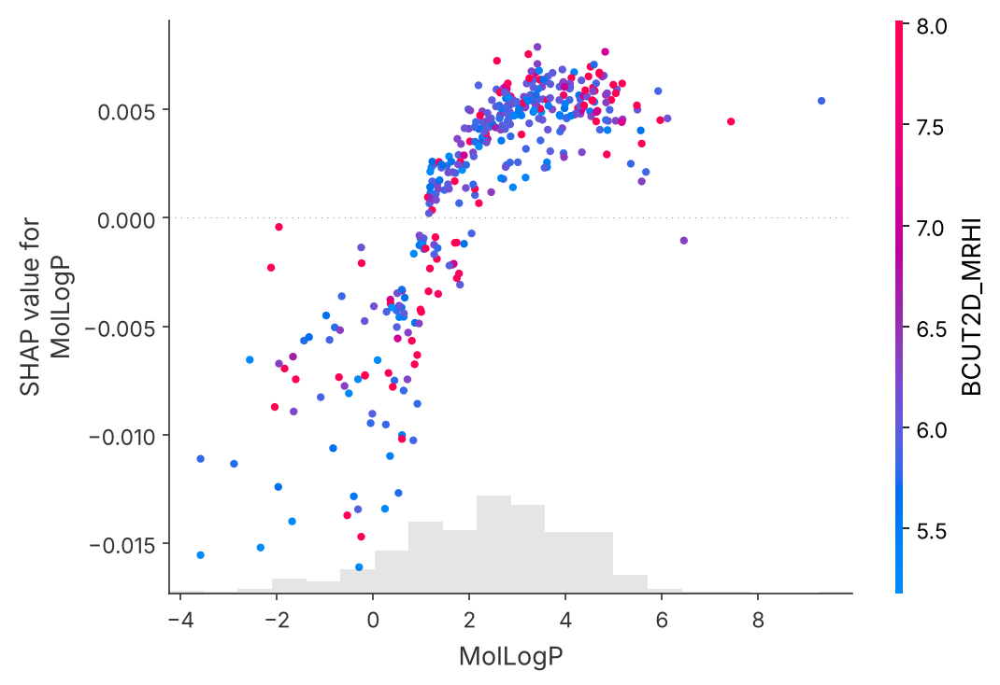

*Same kind of plot for lipophilicity (how oily the molecule is). It slopes upward: higher MolLogP pushes toward "crosses", because oily molecules slip through the barrier's fatty membranes.*

### Explaining single molecules

Morgan fingerprint bits are labelled with the substructure they encode.

| Caffeine — P(BBB+) = 0.94 | Penicillin G — P(BBB+) = 0.01 |
|---|---|
| 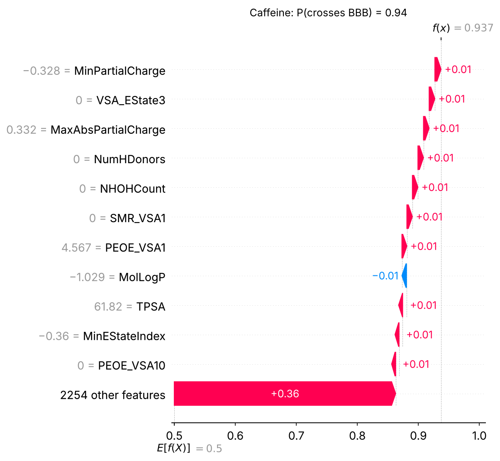 | 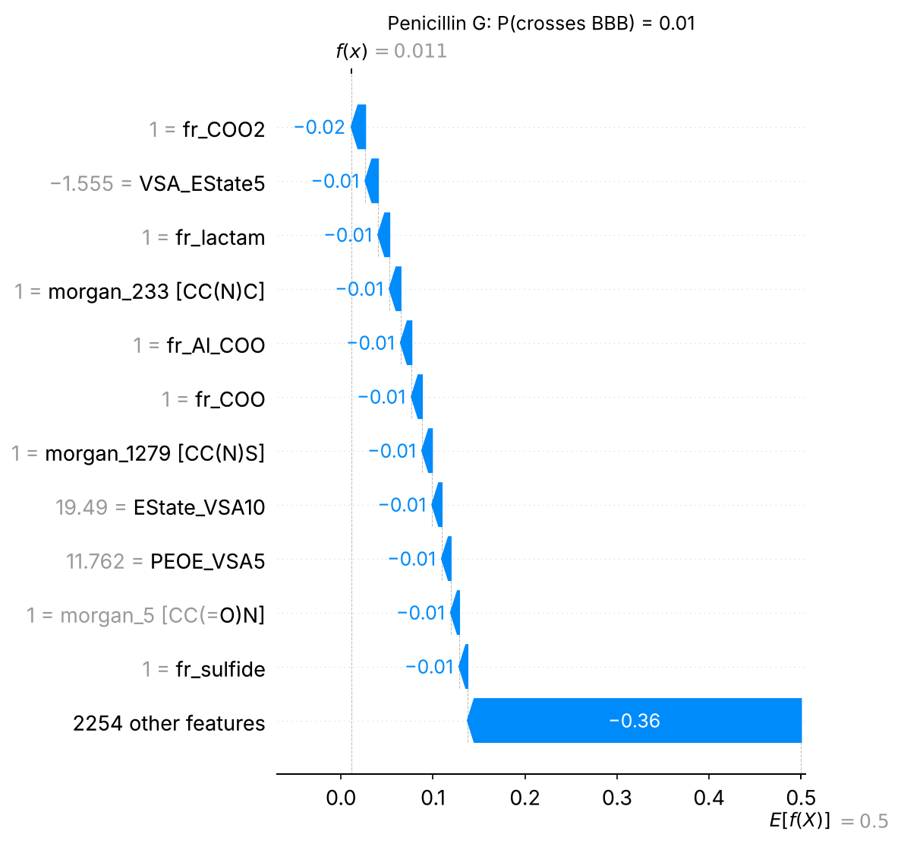 |

*Waterfall plots explain one drug at a time. Starting from the average prediction, each bar adds one feature's push — red bars up (toward "crosses"), blue bars down — until it reaches the final score. Caffeine's bars push up to 0.94 (crosses); penicillin G's push down to 0.01 (blocked), both correct.*

Penicillin G (which indeed does not reach the brain well) is pushed down by its
carboxylic acid, β-lactam and thioether groups.

## How far can we trust it?

`src/evaluate.py` stress-tests the headline number.

### 1. It beats the rules chemists already use

Every model below is scored on the same scaffold-split test set. Rules use no training;
the logistic regression is trained on the same training molecules as the forest.

| Model | ROC-AUC (95% CI) | PR-AUC |
|---|---|---|
| CNS rule of thumb (TPSA < 90, MW < 450, HBD ≤ 3) | 0.747 (0.70 – 0.79) | 0.717 |
| CNS MPO score (Wager 2010, 4 of 6 components) | 0.735 (0.68 – 0.78) | 0.746 |
| TPSA alone | 0.826 (0.78 – 0.87) | 0.843 |
| Logistic regression on 6 classic descriptors | 0.810 (0.77 – 0.85) | 0.807 |
| **Random forest (this project)** | **0.882 (0.85 – 0.91)** | **0.897** |

The forest wins against every baseline in **100% of 2,000 paired bootstrap resamples**.
TPSA alone is a strong baseline (0.83), which shows how much of BBB penetration polarity
explains. The forest's extra ~0.06 AUC comes from substructure and descriptor
interactions. Our CNS MPO leaves out the logD and pKa terms (RDKit can't compute them), so
it understates the published score.

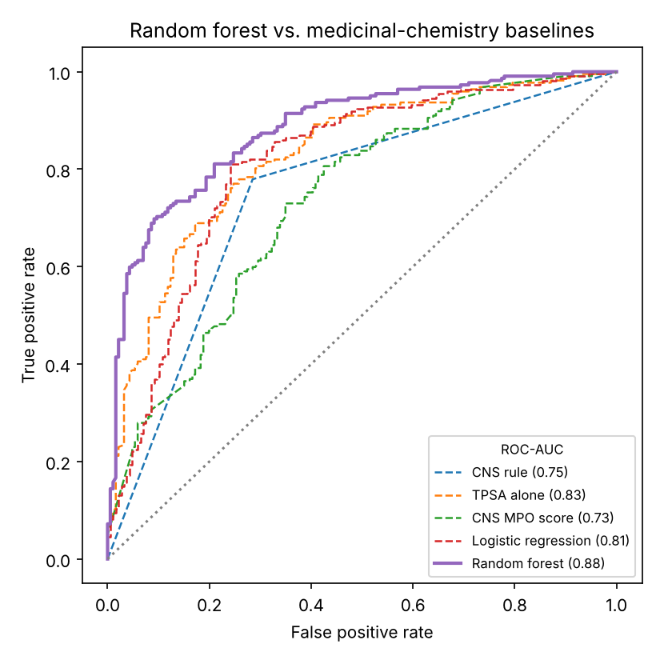

*ROC curves for the random forest against the simple rules chemists already use. The forest's curve (highest AUC) sits above all the baselines, so it ranks molecules better than any of them.*

### 2. The split matters more than the model

The same model with fixed hyperparameters, refit on 5 random and 5 shuffled scaffold splits:

| Split | Test ROC-AUC (mean ± sd) |
|---|---|
| Random (stratified) | 0.933 ± 0.008 |
| Scaffold, shuffled groups | 0.885 ± 0.020 |
| Scaffold, standard (reported above) | 0.882 |

A random split would overstate performance by ~0.05 AUC, because near-copies of test
molecules sit in the training set. The reported number sits in the middle of the
scaffold-split range, so it isn't a lucky split. Expect **0.85 – 0.90** on genuinely new
chemotypes.

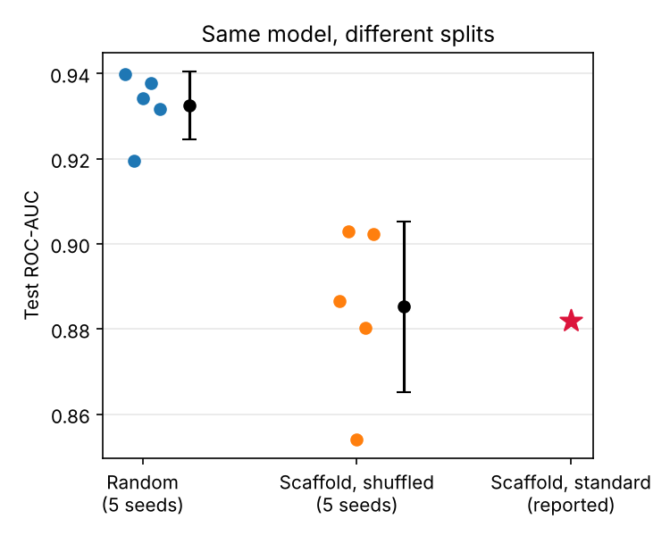

*The same model scored under different ways of splitting train/test. The easy random split (left) looks ~0.05 AUC better because near-copies leak into training; the honest scaffold split (right) is our reported number.*

### 3. Choose the decision threshold, don't assume 0.5

The training data is 82% BBB+, so the forest is biased towards "crosses". At 0.5 it labels
almost everything as penetrant (sensitivity 0.96, specificity 0.45). We picked a threshold
from **out-of-fold training predictions only** (maximising Youden's J, i.e. balanced
accuracy) and applied it unchanged to the test set:

| Threshold | Accuracy | Balanced acc. | MCC | Sensitivity | Specificity |
|---|---|---|---|---|---|
| 0.50 (default) | 0.725 | 0.703 | 0.481 | 0.955 | 0.452 |
| **0.85 (tuned on train CV)** | **0.784** | **0.789** | **0.577** | 0.734 | 0.844 |

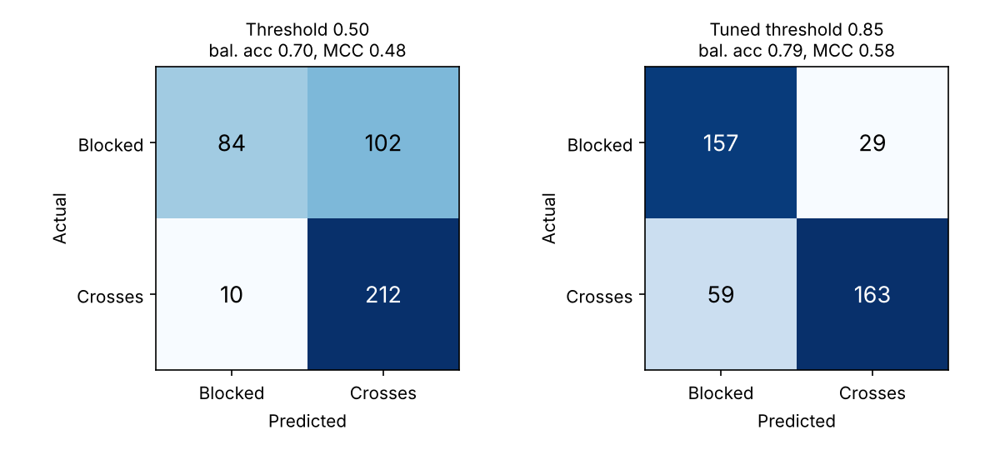

*Counts of correct vs wrong calls at two decision cutoffs. The default 0.5 (left) labels almost everything "crosses"; the tuned 0.85 (right) catches far more of the "blocked" drugs, with a much better balance.*

### 4. Probabilities are over-confident on new chemotypes

On training CV the probabilities are reasonably calibrated (Brier 0.089). On the scaffold
test set they're over-confident in the 0.5 – 0.9 range (Brier 0.182). Isotonic
recalibration fitted on the training CV improves this to 0.160, but some gap remains
because the class balance shifts between train and test. **Read P(BBB+) as a ranking
score, not a literal probability**, especially for unfamiliar scaffolds.

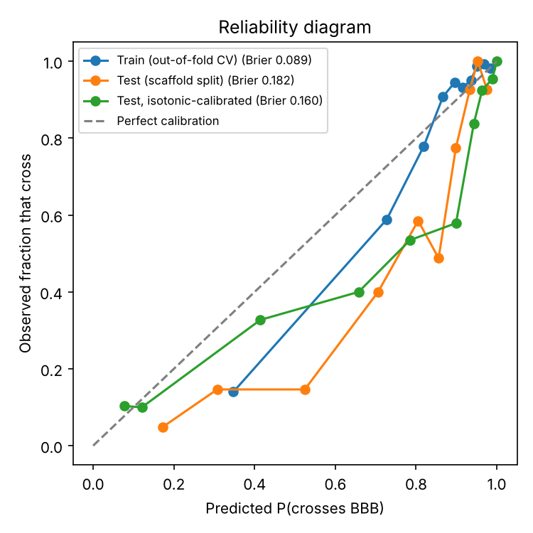

*Checks whether a predicted probability matches reality. A perfectly honest model follows the diagonal. On new chemotypes the curve dips below it, meaning the scores are over-confident — so treat P(BBB+) as a ranking, not a literal probability.*

## Where the model works and where it fails

`src/analysis.py` looks at individual molecules and at the dataset itself.

### Applicability domain: novelty costs accuracy

For each test molecule we take its Tanimoto similarity (Morgan fingerprints) to the
*nearest* training molecule:

| Similarity to train | n | ROC-AUC | Accuracy (tuned) |
|---|---|---|---|
| < 0.3 | 105 | 0.838 | 0.752 |
| 0.3 – 0.4 | 86 | 0.792 | 0.698 |
| 0.4 – 0.5 | 68 | 0.850 | 0.765 |
| 0.5 – 0.7 | 118 | 0.918 | 0.847 |
| ≥ 0.7 | 31 | 0.969 | 0.935 |

Below ~0.5 similarity, accuracy falls from ~0.85–0.94 to ~0.70–0.77. Wrong predictions
average 0.39 similarity vs 0.46 for correct ones. **A practical rule:** report the
nearest-neighbour similarity next to every prediction, and treat predictions below 0.4 as
low-confidence.

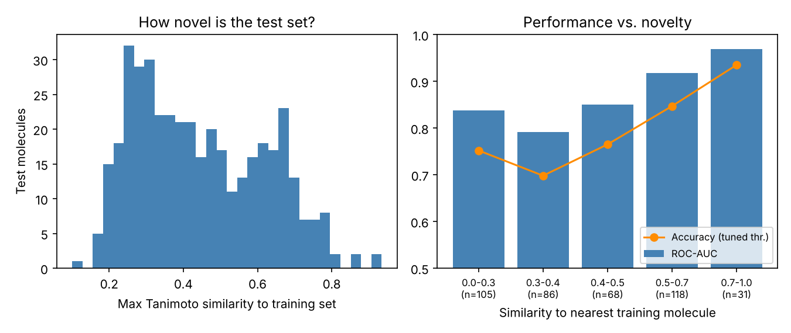

*Accuracy vs how similar a test molecule is to the closest training molecule. The more novel the molecule (left), the less accurate the prediction — which is why predictions below ~0.4 similarity should be treated as low-confidence.*

### Chemical space

A t-SNE map of the Morgan fingerprints. Blocked compounds cluster into a few islands
(β-lactam antibiotics, tetracyclines, steroids/glycosides). Brain-penetrant molecules fill
the large central drug-like region. The scaffold split scatters test molecules across the
map, and errors (red ×) concentrate where the two classes mix.

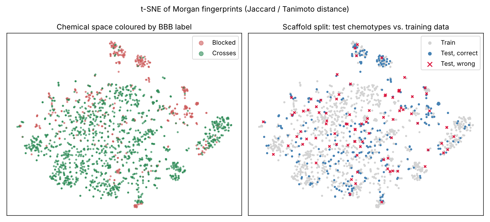

*A 2-D map where structurally similar molecules sit close together. Blocked compounds (one colour) cluster into a few islands; brain-penetrant ones fill the central region. Errors (red ×) bunch up where the two classes overlap.*

### The most confident mistakes

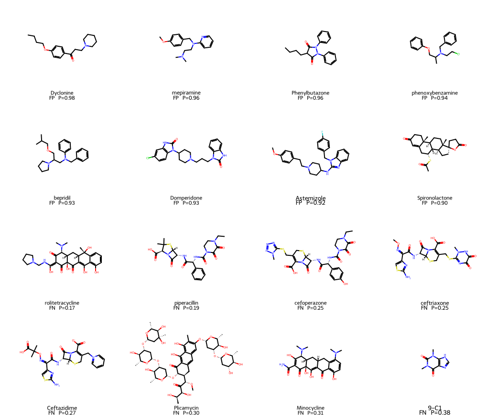

*The molecules the model got most confidently wrong, drawn out with their true label and predicted score. Reading the structures shows the errors aren't random — they're drugs whose brain access depends on transporters, which a structure-only model can't see.*

The errors fall into two clear groups (full table in `outputs/error_analysis.csv`):

- **False positives: lipophilic, low-TPSA drugs labelled "blocked".** Examples include
  domperidone, astemizole, bepridil and phenoxybenzamine. They look textbook CNS-like
  (TPSA 12 – 80 Ų, logP 3 – 5). Several are known substrates of **P-glycoprotein**, an
  efflux pump that throws them back out of the brain. That is active transport, which a
  structure-only passive-permeability model cannot see.
- **False negatives: big, polar antibiotics labelled "crosses".** Examples include
  ceftriaxone, ceftazidime, cefoperazone, piperacillin, minocycline and rolitetracycline
  (TPSA 156 – 220 Ų). They are used against meningitis because they enter the CNS when
  the barrier is **inflamed**, and at high doses. The model's "blocked" call matches their
  physical chemistry. The dataset label reflects clinical use.

So many of the "errors" are arguably label-definition issues, not model failures.

### Label noise in BBBP

There are **15 pairs** of molecules with Tanimoto ≥ 0.9 but opposite labels, and **11 of
them are the exact same structure** listed twice. Examples are propranolol (1 vs 0),
aspirin, atropine, indomethacin, trimetrexate and loperamide/BRL53080. Others are
stereoisomers the fingerprint can't distinguish (quinine/quinidine,
hyoscyamine/atropine). This noise caps the accuracy any model can reach on BBBP. See
`outputs/label_conflicts.csv`.

### Case studies: known drugs the model has never seen

Before predicting, we removed every case-study drug from the training data and refit the
forest, so this is a real out-of-sample test:

| Drug | Known behaviour | P(BBB+) | Correct (tuned thr.) | Why |
|---|---|---|---|---|
| Diazepam | crosses | 1.00 | ✓ | lipophilic, passive diffusion |
| Fluoxetine | crosses | 0.94 | ✓ | passive diffusion |
| Diphenhydramine | crosses | 0.98 | ✓ | sedating 1st-gen antihistamine |
| Hydroxyzine | crosses | 0.98 | ✓ | sedating 1st-gen antihistamine |
| Fexofenadine | blocked | 0.47 | ✓ | zwitterion + P-gp efflux (non-drowsy) |
| Cetirizine | blocked | 0.83 | ✓ | hydroxyzine + a carboxylic acid |
| Dopamine | blocked | 0.48 | ✓ | polar neurotransmitter |
| Atenolol | blocked | 0.79 | ✓ | hydrophilic beta-blocker |
| Gabapentin | crosses | 0.85 | ✓ | amino acid, LAT1 transporter |
| Loperamide | blocked | 0.88 | ✗ | P-gp efflux keeps this opioid out |
| Domperidone | blocked | 0.94 | ✗ | P-gp efflux |
| L-DOPA | crosses | 0.37 | ✗ | polar, but carried in by LAT1 |

The forest gets **9/12** right at the tuned threshold (7/12 at 0.5). It correctly tells
apart the sedating and non-sedating antihistamine pairs. Its three failures are exactly the
drugs whose BBB behaviour depends on **transporters**, not passive diffusion: two P-gp
efflux substrates and L-DOPA, which LAT1 carries into the brain. This is the clearest
limitation of a structure-only model.

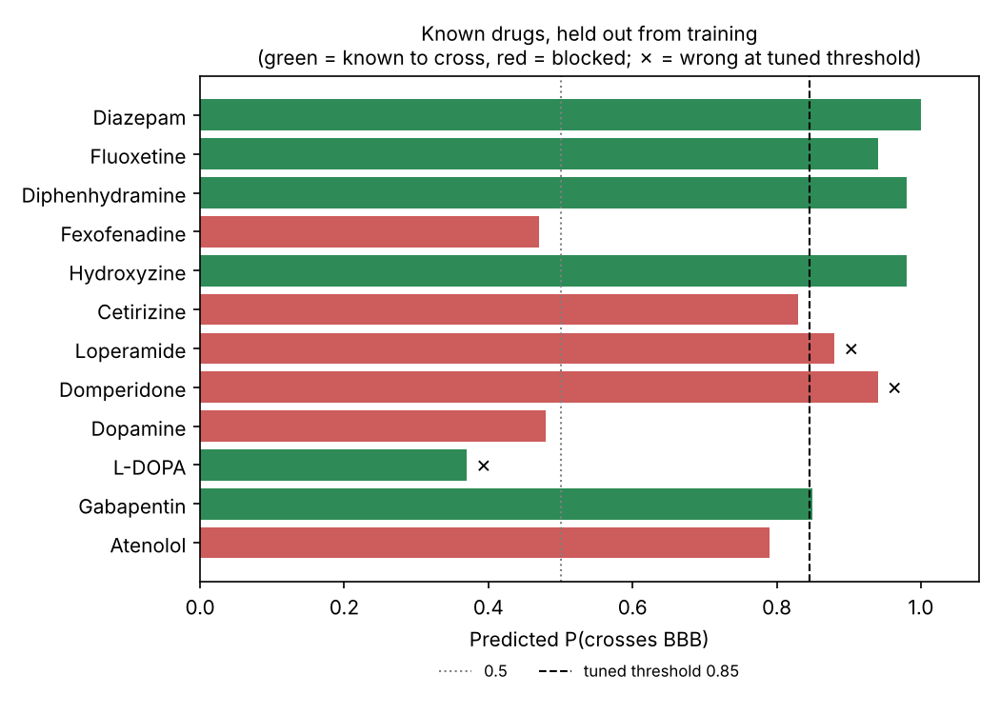

*Twelve well-known drugs that were removed from training before predicting, so this is a genuine out-of-sample test. Green = the model agreed with the known behaviour, red = it missed — and every miss is a transporter-driven drug.*

### Limitations

- BBBP labels are binary and come from mixed sources, with known duplicates and conflicts.
- The model learns passive permeability. Efflux (P-gp, BCRP) and uptake transporters
  (LAT1, GLUT1) are invisible to it unless similar molecules are in the training data.
- Brain exposure also depends on dose, plasma protein binding and metabolism, none of
  which the model sees.
- Use it to rank and triage candidates, alongside the applicability-domain check, not as
  a definitive yes/no.

## Approach

1. **Data** — [BBBP](https://moleculenet.org/datasets-1) from MoleculeNet: 2,050 compounds
   labelled BBB-penetrating (1) or not (0) (Martins et al., *J. Chem. Inf. Model.* 2012, 52, 1686). 11 unparseable SMILES are dropped; salts and
   counter-ions are stripped (largest fragment kept).
2. **Features** (`src/features.py`) — 217 RDKit physico-chemical descriptors + 2048-bit
   Morgan fingerprint (radius 2, ≈ ECFP4).
3. **Model** (`src/train.py`) — `RandomForestClassifier`, tuned with a 20-trial randomized
   search over trees, depth, `max_features`, leaf size and class weighting, using
   scaffold-grouped 5-fold CV on the training set only. Best:
   800 trees, `max_features="log2"`, `max_depth=40`, `class_weight="balanced_subsample"`.
4. **Final model** — refit on all data and saved to `outputs/rf_bbbp.joblib`.

## Usage

```bash
pip install -r requirements.txt
python src/train.py          # ~5 min on a laptop; writes outputs/
python src/explain.py        # ~3 min; SHAP plots in outputs/
python src/evaluate.py       # ~2 min; baselines, CIs, split comparison, threshold, calibration
python src/analysis.py       # ~1 min; applicability domain, errors, label noise, case studies
python src/predict.py "CN1C=NC2=C1C(=O)N(C(=O)N2C)C"   # caffeine
```

## Project structure

```
data/BBBP.csv            MoleculeNet BBBP dataset
src/features.py          SMILES → descriptors + fingerprints, scaffolds
src/data.py              data loading, scaffold split, shared train-split model
src/train.py             RF tuning, evaluation, plots
src/predict.py           predict BBB penetration for new SMILES
src/explain.py           SHAP analysis: global + per-molecule explanations
src/evaluate.py          trustworthiness: baselines, bootstrap CIs, splits, threshold, calibration
src/analysis.py          applicability domain, error analysis, label noise, case studies, t-SNE
outputs/                 metrics, plots and CSV/JSON reports from all scripts
```
