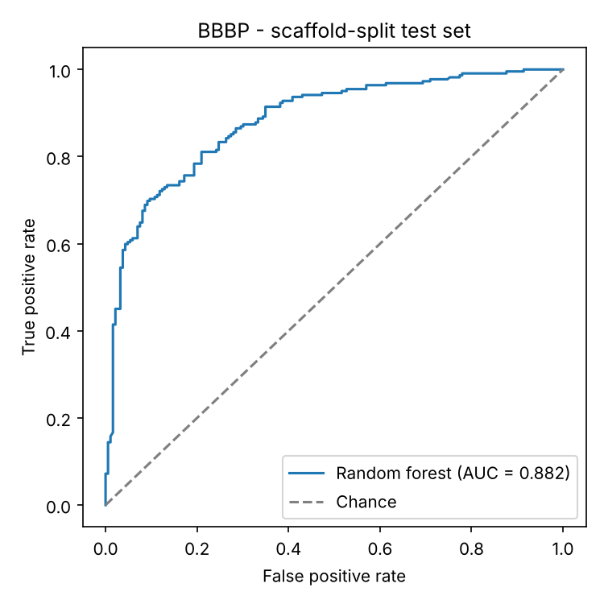
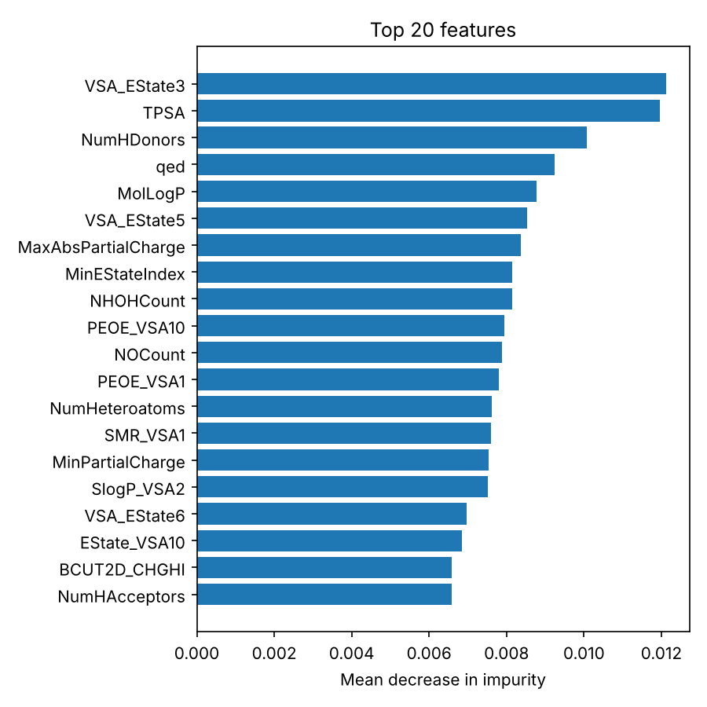

# ChemAI: Predict the Cure — Blood-Brain Barrier Penetration with a Random Forest

A drug for a brain disease only works if it can actually **reach the brain**. Most
molecules are blocked by the blood-brain barrier (BBB). This project predicts, from a
molecule's structure alone (its SMILES string), whether it will cross the BBB — using a
**single random forest** model.

## Results

Evaluated on a **scaffold split**: test molecules have core structures (Bemis-Murcko
scaffolds) never seen in training, which mimics predicting genuinely new drug candidates
and is much harder than a random split.

| Metric (held-out test, 408 molecules) | Score |
|---|---|
| ROC-AUC | **0.882** |
| PR-AUC | 0.897 |
| F1 | 0.791 |
| Accuracy | 0.726 |
| 5-fold scaffold-grouped CV ROC-AUC (train) | 0.890 |

The scaffold split shifts class balance (82% BBB+ in train vs 54% in test), which is why
accuracy at a fixed 0.5 threshold trails the ranking metrics.



### What the model learned

The most important features are the ones medicinal chemists already use to judge brain
penetration — a good sanity check:

- **TPSA** (topological polar surface area) — polar molecules struggle to cross
- **NumHDonors / NHOHCount** — hydrogen-bond donors hurt permeability
- **MolLogP** — lipophilicity helps passive diffusion through membranes
- **qed** — overall drug-likeness



## Approach

1. **Data** — [BBBP](https://moleculenet.org/datasets-1) from MoleculeNet: 2,050 compounds
   labelled BBB-penetrating (1) or not (0). 11 unparseable SMILES are dropped; salts and
   counter-ions are stripped (largest fragment kept).
2. **Features** (`src/features.py`) — 217 RDKit physico-chemical descriptors + 2048-bit
   Morgan fingerprint (radius 2, ≈ ECFP4).
3. **Model** (`src/train.py`) — `RandomForestClassifier`, tuned with a 20-trial randomized
   search over trees, depth, `max_features`, leaf size and class weighting, using
   scaffold-grouped 5-fold CV on the training set only. Best:
   800 trees, `max_features="log2"`, `max_depth=40`, `class_weight="balanced_subsample"`.
4. **Final model** — refit on all data and saved to `outputs/rf_bbbp.joblib`.

## Usage

```bash
pip install -r requirements.txt
python src/train.py          # ~5 min on a laptop; writes outputs/
python src/predict.py "CN1C=NC2=C1C(=O)N(C(=O)N2C)C"   # caffeine
```

## Project structure

```
data/BBBP.csv            MoleculeNet BBBP dataset
src/features.py          SMILES → descriptors + fingerprints, scaffolds
src/train.py             scaffold split, RF tuning, evaluation, plots
src/predict.py           predict BBB penetration for new SMILES
outputs/                 metrics.json, roc_curve.png, feature_importance.png, top_features.csv
```
